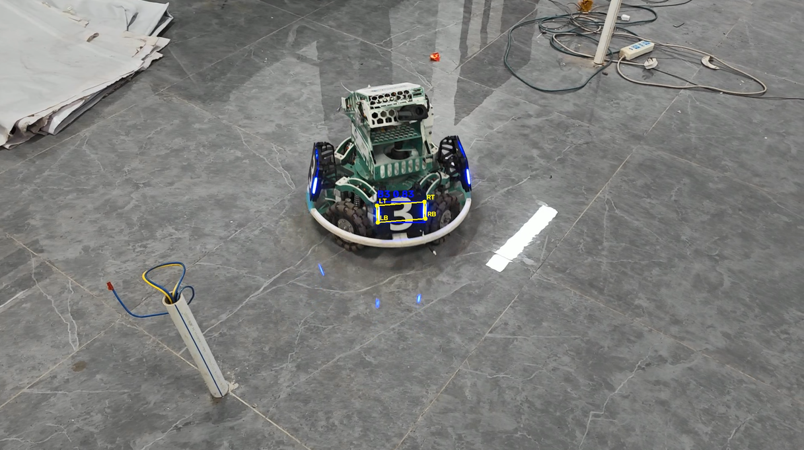
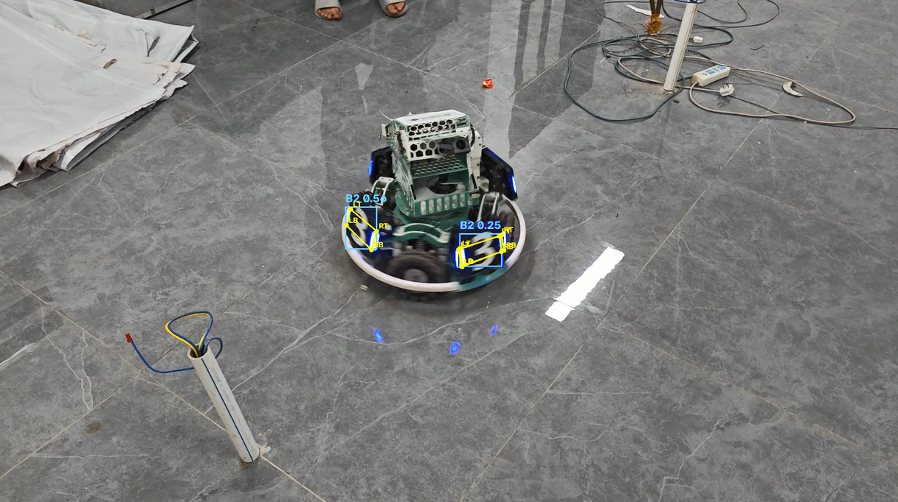
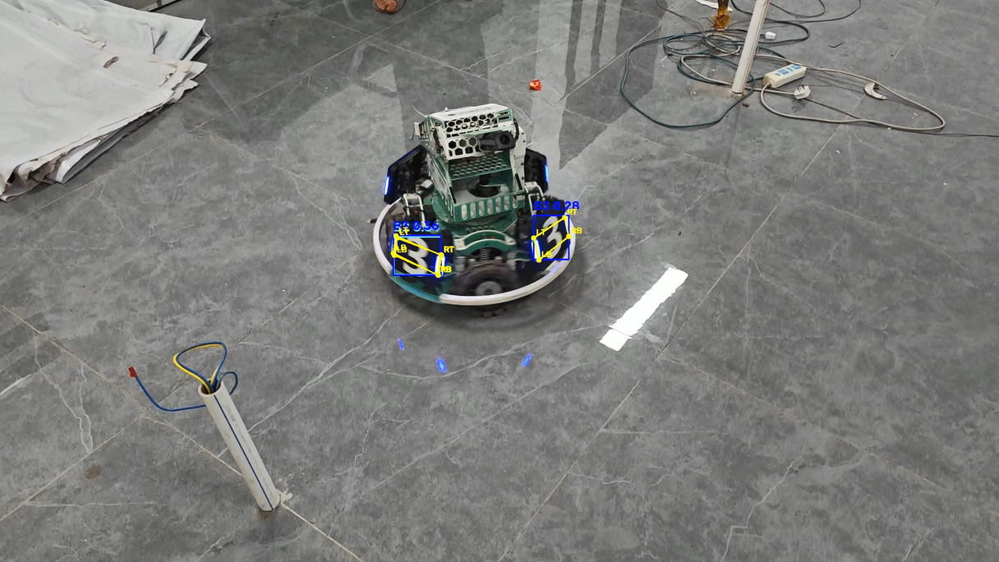
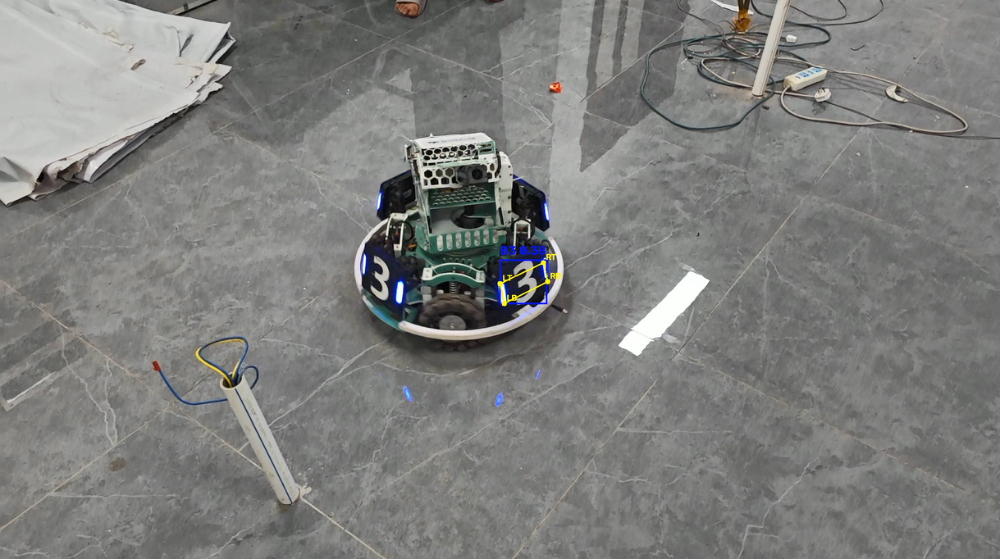
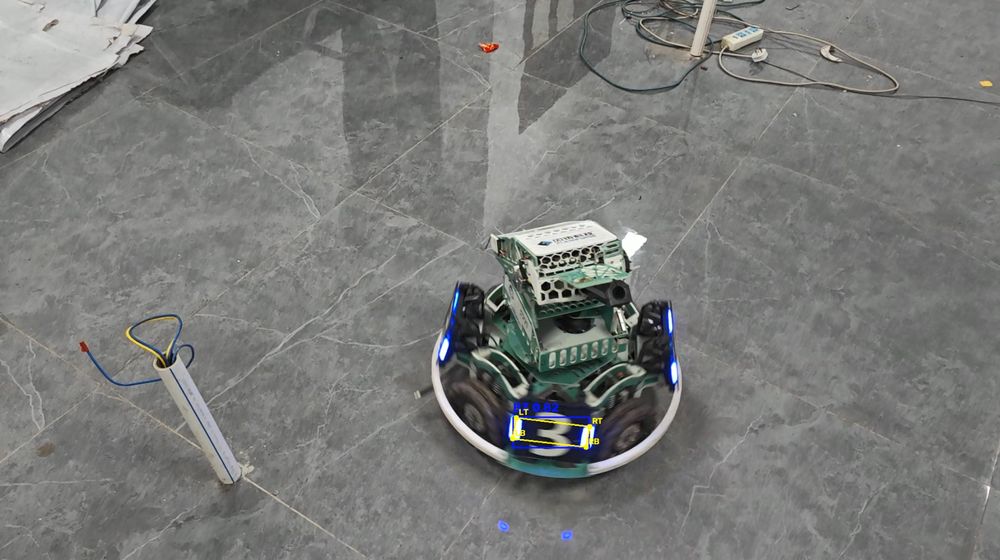
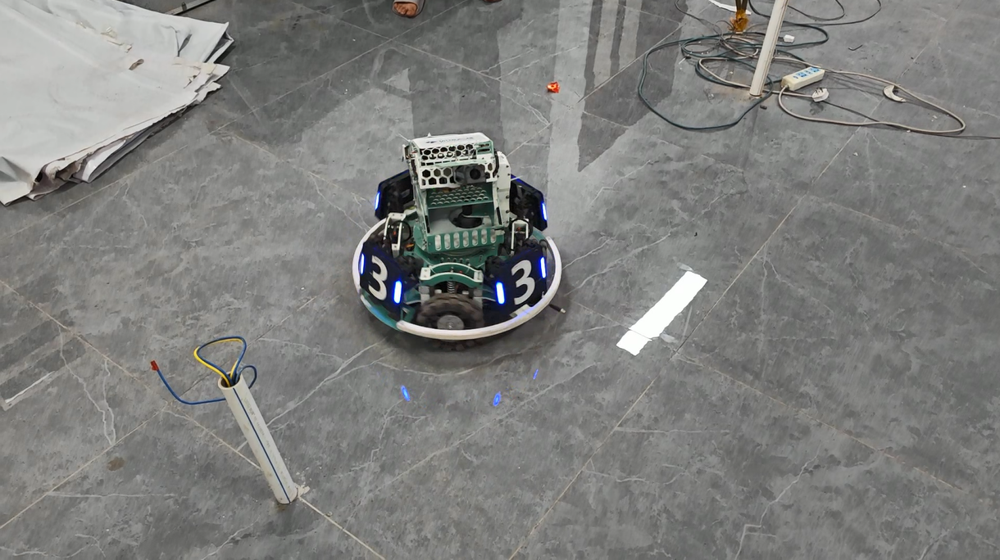
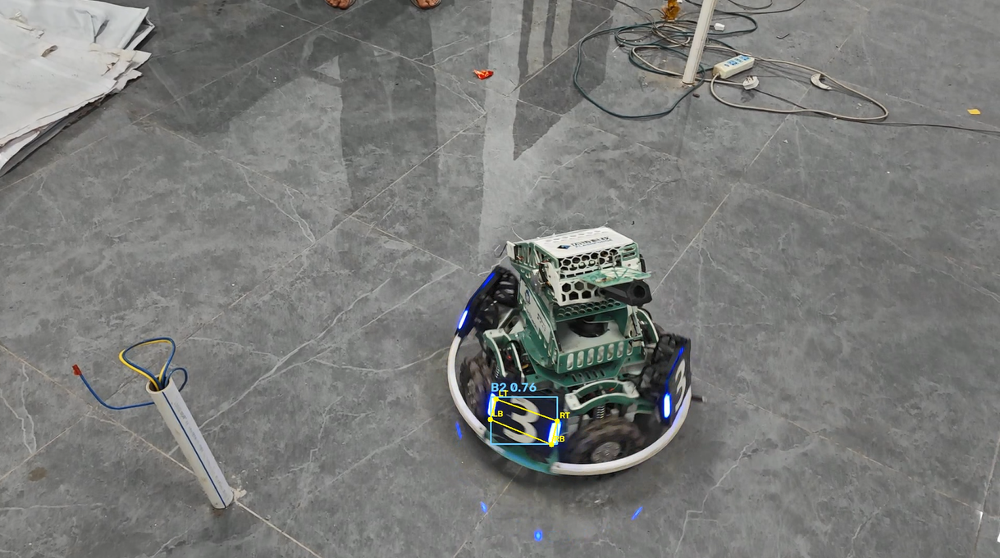

# YOLO26 Pose 装甲板检测与四关键点推理

> 使用课程提供的 YOLO26n Pose 模型权重 `best.pt`，对自行拍摄的机器人装甲板视频进行离线推理，绘制目标检测框、类别、置信度以及模型预测的四个关键点，最终保存推理结果视频。项目包含两组实际实验记录：初始置信度阈值 **0.25** 与第二次 PR 调整后的 **0.70**。

## 1. 项目简介与已实现功能

本项目使用 **Ultralytics YOLO Pose + OpenCV** 完成：

- 加载课程提供的 `weights/best.pt`，无需重新训练模型。
- 读取自行拍摄的 `videos/original.mp4`，逐帧进行装甲板检测。
- 按模型类别映射输出 `B1`、`B2`、`B3`、`R1`、`R2`、`R3` 六类预测。
- 绘制检测框、类别名称与置信度分数。
- 从模型的 Pose 结果中读取并绘制四个关键点 `LT`、`LB`、`RB`、`RT`，使用连线展示四边形轮廓。
- 在 `results/output.mp4` 中保存可播放的推理视频。
- 将推理置信度阈值集中设置为 `CONF_THRESHOLD = 0.70`，便于后续对照实验。

**功能边界：**模型具备六类输出能力，并不代表本次视频验证了全部六类的识别准确性。实验截图主要涉及 `B2` 和 `B3` 预测。本项目仅完成**离线视频推理及可视化**，未实现 PnP 位姿解算、云台控制、实时相机接入或机器人自动瞄准。

## 2. 实际开发与运行环境

| 项目 | 本地实测配置 |
| --- | --- |
| 操作系统 | Windows 10（VS Code） |
| Python | **3.10.22** |
| 环境管理 | Anaconda / Conda，环境名 `yolo26` |
| Ultralytics | `8.4.177` |
| PyTorch | `2.14.1+cpu` |
| Torchvision | `0.29.1` |
| OpenCV Python 安装包 | `opencv-python==5.0.0.93`（`cv2.__version__` 显示 `5.0.0`） |
| NumPy | `2.2.6` |
| CUDA 可用性 | `False` |
| 实际推理设备 | **CPU** |

环境验证命令：

```bash
python --version
python -c "import sys, torch, ultralytics, cv2, numpy; print('Python:', sys.version.split()[0]); print('Torch:', torch.__version__); print('Ultralytics:', ultralytics.__version__); print('OpenCV:', cv2.__version__); print('NumPy:', numpy.__version__); print('CUDA available:', torch.cuda.is_available())"
```

> 此处记录的是实际成功运行推理的本机环境，不代表所有操作系统及 CUDA 配置均已测试。其他机器安装 PyTorch CPU 或 CUDA 构建时，需要根据平台选择对应的官方安装来源。

## 3. 项目目录

```text
yolo-armor-inference/
├── infer.py                         # YOLO26 Pose 视频推理程序
├── README.md                        # 项目说明与实验记录
├── requirements.txt                 # Python 依赖
├── .gitignore                       # Git 忽略规则
├── images/                          # 已提交的真实实验截图
│   ├── 01_success_B3.png
│   ├── 02_multi_armor_B2.png
│   ├── 03_class_confusion_B2_B3.png
│   ├── 04_left_armor_miss_detection.png
│   ├── 05_conf070_detection.png
│   ├── 06_conf070_missed_detection.png
│   └── 07_conf070_class_error.png
├── weights/                          # 不纳入 Git 历史
│   └── best.pt                      # 课程提供的 Pose 模型权重
├── videos/                           # 不纳入 Git 历史
│   └── original.mp4                 # 自拍原始视频
└── results/                          # 不纳入 Git 历史
    └── output.mp4                   # 程序生成的结果视频
```

仓库克隆后可能不包含 `weights/`、`videos/`、`results/` 目录，因为这些目录通过 `.gitignore` 排除，需要在本地按下面的步骤自行建立。

## 4. 模型权重和输入视频准备

1. 从**课程提供的参考资料**中获取预训练模型 `best.pt`。本项目直接使用该权重，不执行模型训练。
2. 在项目根目录创建 `weights/`，将权重放到 `weights/best.pt`。
3. 在项目根目录创建 `videos/`，把自摄视频放到 `videos/original.mp4`。
4. 确保从包含 `infer.py` 的项目根目录运行脚本，因为脚本使用相对路径。

本地已确认模型任务为 `pose`。权重中的类别映射为：

```text
0 -> B1
1 -> B2
2 -> B3
3 -> R1
4 -> R2
5 -> R3
```

上述映射为**模型类别名称**；识别结果是否与真实装甲板号码一致，仍须结合画面或人工标注判断。

## 5. 安装和运行方法

### 5.1 配置 Conda 环境

在 Windows CMD、Anaconda Prompt 或正确配置 Conda 的终端中执行：

```bash
conda create -n yolo26 python=3.10 -y
conda activate yolo26
```

若已有 `yolo26` 环境，只需执行 `conda activate yolo26`。

### 5.2 安装依赖

在项目根目录执行：

```bash
python -m pip install -r requirements.txt
```

依赖版本来自本地已运行环境；在其他平台上，PyTorch 的 CPU/CUDA 安装包可能需要根据官方安装说明选择相应的软件包源。

### 5.3 当前版本的运行参数

第二次 PR 将推理置信度阈值从 **`0.25` 调高至 `0.70`**。`infer.py` 顶部相关配置为：

```python
MODEL_PATH = "weights/best.pt"
VIDEO_PATH = "videos/original.mp4"
SAVE_PATH = "results/output.mp4"
CONF_THRESHOLD = 0.70
```

在逐帧推理时，把阈值变量传入 Ultralytics：

```python
results = model(
    frame,
    imgsz=640,
    conf=CONF_THRESHOLD,
    verbose=False
)
```

`0.70` 指**检测候选结果的最低置信度门槛**，不是模型准确率达到 70%。提高该值不会修改模型权重或重新训练模型。

### 5.4 执行推理

```bash
python infer.py
```

程序加载模型、读取视频、逐帧绘制目标框及四个 Pose 关键点，并输出：

```text
results/output.mp4
```

若视频预览窗口支持 Esc 提前结束，提前退出可能只得到部分视频；完整实验请运行到原视频结束。若已存在 `output.mp4`，测试前后应注意区分新旧生成结果。

## 6. 视频采集信息

| 项目 | 本次实验 |
| --- | --- |
| 拍摄地点 | 实验室 |
| 拍摄设备 | 手机摄像头 |
| 时长 | 约 **16 秒** |
| 分辨率 | **1920 × 1080（1080p）** |
| 帧率 | **30 FPS** |
| 视频格式 | MP4 |
| 拍摄内容 | 室内带装甲板机器人移动、转向，产生不同观察角度 |

视频包含正面与斜视角下的装甲板，画面存在运动模糊、反光及背景干扰等实际情况。实验为**离线视频推理**，不以此声称已完成实时部署。

## 7. 首次实验：置信度阈值 0.25（PR #1）

本节四张截图保留自初始版本（`conf=0.25`），**不是 `conf=0.70` 下重新生成的结果**。

### 7.1 B3 单目标检测



**观察：**一个装甲板被标注为 `B3 0.83`，可见检测框与四个预测关键点。

### 7.2 同帧多目标候选



**观察：**同帧出现两个 `B2` 候选结果，置信度约 `0.50` 和 `0.25`。说明程序能够绘制多个候选框，但不等于所有类别预测都正确。

### 7.3 B2 / B3 跨类别重叠预测



**观察：**同一装甲板区域出现不同类别的重叠预测框，属于重复预测和类别混淆，不能将其直接当成两个真实装甲板。可能与相似纹理、拍摄角度、置信度分布或跨类别 NMS 行为有关；尚未通过对照实验确定唯一原因。

### 7.4 部分装甲板漏检



**观察：**画面左侧可见装甲板却没有相应检测框；另一侧有 `B3` 检测输出。该现象应如实保留，不能只展示成功帧。

## 8. 第二次实验：将阈值提高至 0.70（PR #2）

### 8.1 调整内容与目的

本次 PR 对推理脚本进行**参数配置调整**：

| 配置项 | 原始版本 | 第二次 PR |
| --- | --- | --- |
| `conf` | `0.25` | **`0.70`** |
| `imgsz` | `640` | `640`（保持不变） |
| 模型权重 | `weights/best.pt` | 未改变 |
| 视频输入 | `videos/original.mp4` | 未改变 |

将 `CONF_THRESHOLD = 0.70` 作为独立配置项，在推理时传入 `conf=CONF_THRESHOLD`。调整目的在于**过滤低置信度候选框**，观察画面是否更简洁，同时记录由此可能带来的漏检风险。

高阈值**不能保证分类正确**：类别预测错误但置信度较高的结果仍可能被保留。对跨类别重叠框，它也不能替代针对性的 NMS 或分类错误分析。

### 8.2 案例 05：成功输出检测框及关键点



**观察：**画面中前侧装甲板输出 `B2 0.82`，检测框和 `LT/LB/RB/RT` 四个预测点可见，说明在较高阈值下仍能够输出装甲板位置和 Pose 关键点。这里的“成功”主要指**检测与关键点可视化正常**；具体类别是否与目标真实编号一致，应按实际标签核对，不能仅凭一个预测值证明分类正确。

### 8.3 案例 06：装甲板漏检



**观察：**机器人前方装甲板在画面中可见，但该帧未出现检测框或预测关键点，属于漏检示例。提高阈值可能过滤原本分数不足的真实目标；但仅凭这一帧不能断定漏检完全由阈值上调造成，还可能受到运动模糊、角度、遮挡等因素影响。

### 8.4 案例 07：仍然存在类别错误



**观察：**画面可见标有数字 `3` 的装甲板区域，而模型显示 `B2 0.76`，并绘制了检测框和预测关键点。按本项目的 `B2/B3` 类别命名，该帧被记录为**类别识别错误**。这说明即使置信度超过 `0.70`，仍可能出现高置信度误分类；阈值过滤不能直接修正类别标签。

### 8.5 两次实验的解释与局限

- `conf=0.70` 相比 `0.25` 将过滤更多低置信度候选，**但可能同时增加真实目标漏检**。
- 第二次实验保留了检测成功、漏检和类别错误三种情况，避免只用效果较好的帧下结论。
- 两组截图并非严格对齐的同一视频帧，因此**不据此计算准确率提升、误检下降百分比或漏检增加百分比**。
- 由于没有逐帧真值标注与系统性统计，本次调整定位为**推理参数实验**，而非模型性能已改善的定量证明。

后续若需要严谨对比，可以用同一段原视频、同一模型与 `imgsz=640`，分别运行 `conf=0.25` 和 `conf=0.70`，保存为不同结果视频，再对相同时间戳统计检测数、误检数、漏检数和分类正确率。

## 9. Pose 关键点定义及绘制规则

模型输出的四个关键点按照当前脚本约定绘制：

| 下标 | 标记 | 含义 |
| --- | --- | --- |
| 0 | `LT` | Left Top（左上） |
| 1 | `LB` | Left Bottom（左下） |
| 2 | `RB` | Right Bottom（右下） |
| 3 | `RT` | Right Top（右上） |

按照 `0 → 1 → 2 → 3 → 0` 的顺序连接四个点。关键点坐标从 `result.keypoints.xy` 中读取，**不使用检测框的四角替代 Pose 预测**。上述下标映射为当前程序的可视化约定；正式用于几何测量之前，应与原始数据集的关键点标注顺序核对。

## 10. 已知问题及后续改进方向

| 观察到的问题 | 当前记录或处理 | 后续验证方向 |
| --- | --- | --- |
| 初始关键点坐标解包问题 | 使用模型实际返回的 `(x, y)` 结构读取预测坐标 | 增加维度检查及异常输入处理 |
| 初始版本 B2/B3 重叠检测 | 保留问题截图，不声称已修复 | 比较 IoU、跨类别 NMS 和同位置候选类别 |
| 高阈值下仍然漏检 | 记录 `06_conf070_missed_detection.png` | 同帧对比 `conf=0.25/0.70`，检查分数分布 |
| 高置信度类别误判 | 记录 `07_conf070_class_error.png` | 检查模型类别映射、真实标签和训练数据 |
| 关键点随视角改变存在不稳定风险 | 直接显示模型的预测点及四边形 | 核对标注顺序并扩充不同角度样本 |

本项目没有重新训练模型，也没有完成系统性的 mAP、召回率或实时 FPS 评测；不提供未实际测量的性能指标。

## 11. 文件管理与 GitHub PR 工作流

**纳入 Git 历史：**

- `infer.py`
- `README.md`
- `requirements.txt`
- `.gitignore`
- `images/` 内的七张实验截图

**由 `.gitignore` 排除，不纳入 Git 历史：**

- `weights/`：模型权重
- `videos/`：原始实验视频
- `results/`：推理结果视频
- 虚拟环境、缓存、日志及 IDE 本地配置等

复现项目需要自行准备模型权重和视频。课程要求单独提交的模型、原视频与推理视频，按作业平台要求作为附件提交，不通过 GitHub 历史保存。

开发流程：

- **PR #1：**通过 `feature/yolo-inference` 分支加入推理代码、依赖、文档及前四张实验截图，并合并到 `main`。
- **PR #2（本次修改）：**在独立开发分支中将 `CONF_THRESHOLD` 调整为 `0.70`，补充本 README 的实验说明及第 05～07 张新截图，作为提交到 `main` 的 Pull Request 内容。

## 12. 总结

项目实现了基于课程提供的 YOLO26 Pose 模型的**机器人装甲板离线视频检测、六类候选输出与四关键点可视化**。第一次实验（`conf=0.25`）记录了成功检测、多目标候选、类别混淆及漏检；第二次实验（`conf=0.70`）验证了较高门槛下仍可产生有效检测，同时存在漏检和高置信度类别错误。

**结论：提高置信度阈值是一种候选框筛选策略，不是模型精度提升的充分证据。** 后续需要基于相同视频帧及真值标注开展可量化对照实验。
